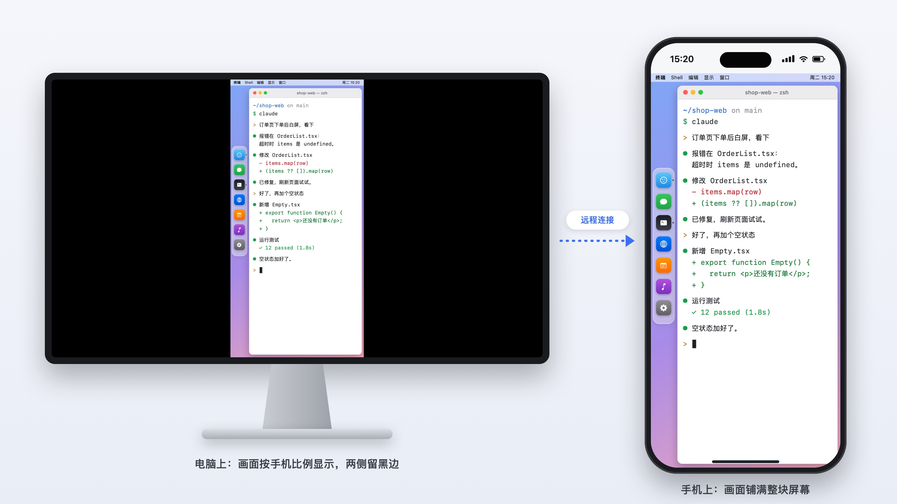
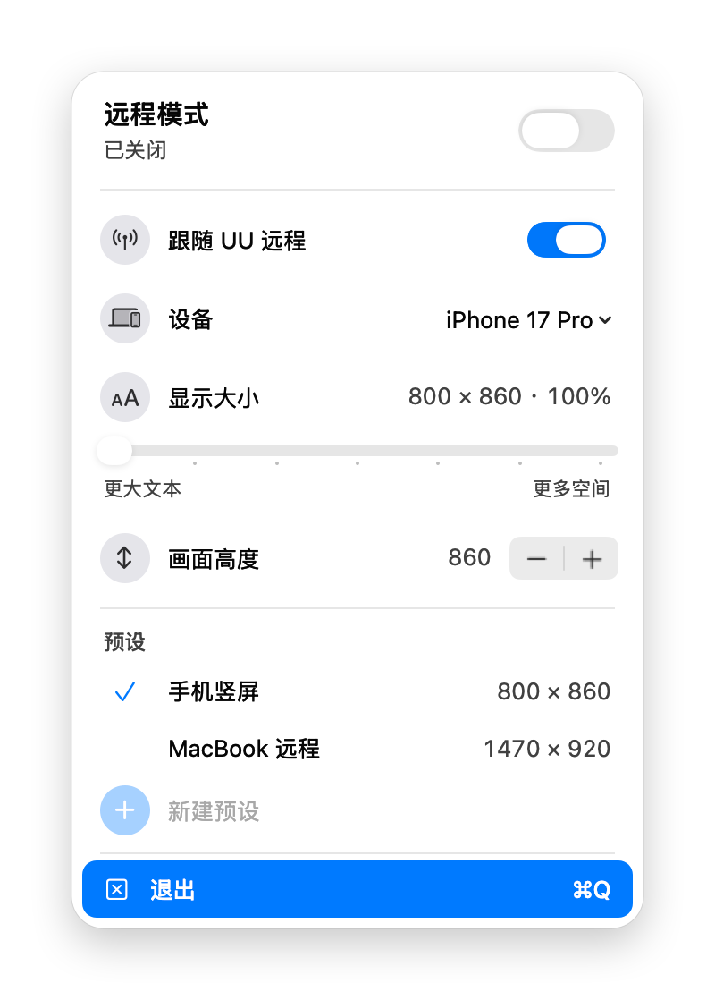

<p align="center"></p>

<h1 align="center">PhoneMode（远程模式）</h1>

<p align="center">Control your Mac from your phone, with the screen filling it just right.</p>

<p align="center">When you control a Mac remotely, PhoneMode resizes its screen to match the device you're using: big enough text on a phone, no black bars on a computer.<br>A free, open-source Mac menu bar app.</p>

<p align="center"><a href="#install">Install</a> · <a href="README.md">中文</a></p>

Control a computer from your phone and the wide landscape screen shrinks into a tall portrait phone. The text is too small to read, and the bottom half of the phone is taken up by the keyboard. Control a computer with an ultrawide monitor from a laptop and you get black bars above and below, with a thin strip in the middle. Remote desktop apps change the resolution on their own, and you can't turn that off.

PhoneMode creates a virtual display as the main screen, sized for the device you're controlling from:

- **Sized for your device**: pick your phone by brand and model, and the screen fits exactly between the status bar and the keyboard. For a computer, pick a 13-inch laptop or a 27-inch monitor, and the screen fills it with no black bars
- **Follows UU Remote**: turns on when NetEase UU Remote connects, and turns off about 6 seconds after it disconnects, restoring your original resolution
- **Fine-tune on the fly**: drag Display Size to scale everything, or shorten Screen Height to make room for the keyboard
- **Presets**: save a size as a preset and switch to it with one click. Switching between phone and computer doesn't drop the remote session

<p align="center"></p>

## Usage

<p align="center"><picture><source media="(prefers-color-scheme: dark)" srcset="docs/screenshot-dark.png"></picture></p>

1. Click the line-chart icon in the menu bar to open the panel. A hollow box means off; a filled box means on
2. Under "Device", pick what you're controlling from: your phone model, or a laptop or monitor
3. "Follow UU Remote" is on by default, so PhoneMode switches as soon as UU connects. You can also use the switch at the top
4. If the text is too big or too small, drag "Display Size". If the keyboard covers the bottom of the screen, click − next to "Screen Height"
5. When it looks right, click "New Preset" to save it. Double-click a preset to rename it; right-click to overwrite it with the current size or delete it
6. Click "Quit" or press ⌘Q to restore your displays

## Install

Download `PhoneMode-<version>.dmg` from [Releases](https://github.com/cyanext/PhoneMode/releases), open it and drag 远程模式 (PhoneMode) into Applications. The first time you open it, macOS says it can't verify the developer. Go to System Settings › Privacy & Security and click "Open Anyway" at the bottom.

Requires macOS 12 or later, on Apple silicon or Intel. The interface follows your system language: Chinese or English. When a new version is out, PhoneMode tells you, and clicking "Update" downloads and installs it. If the remote screen is on, it waits until it's off.

## What it changes on your Mac

- The resolution change is temporary. When PhoneMode turns off or quits, your displays go back to normal, and the resolution you chose in System Settings is never changed
- If Crisp, BetterDisplay or a similar virtual display tool is running, PhoneMode quits it before turning on and reopens it afterward
- The only network access is a daily check for new versions on GitHub: a single request with no information about your Mac

## Build from source

Requires the Xcode command line tools:

```bash
make install
```

## License

[MIT](LICENSE)
