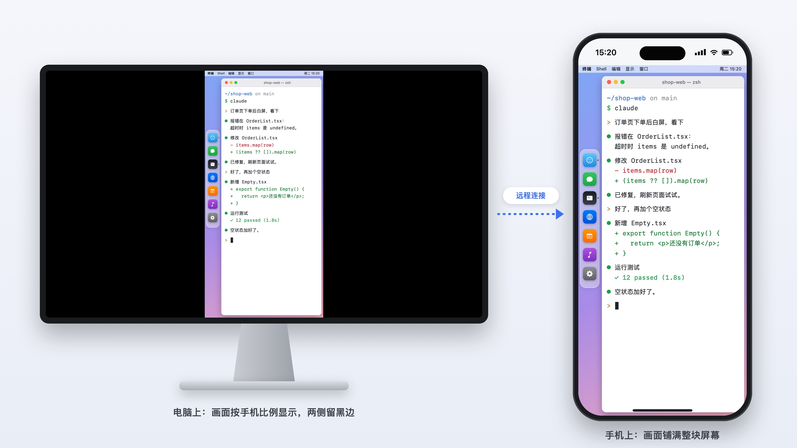
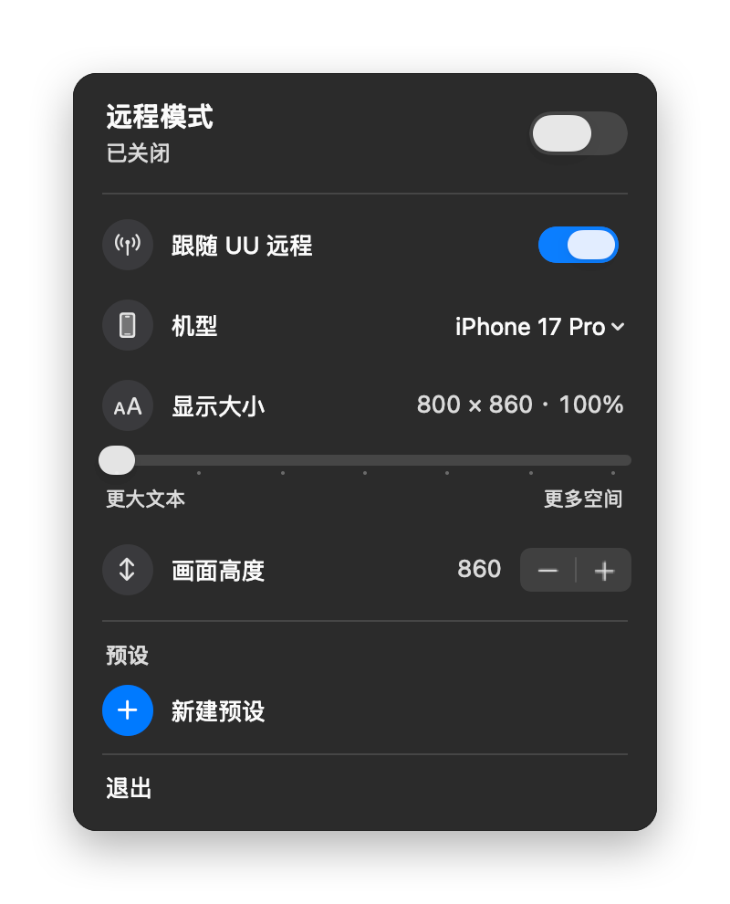

<h1 align="center">PhoneMode 远程模式</h1>

远程控制电脑时，把电脑画面调成控制端屏幕的比例：手机上字够大，电脑上不留黑边。

## 为什么需要它

用手机远程电脑，整块横着的屏幕缩进竖着的手机里，字小得看不清，手机下半屏还要留给输入法。用笔记本远程一台接着带鱼屏的电脑，画面上下全是黑边，中间只剩一条。远程软件自己会改分辨率，也关不掉。

远程模式建一块虚拟屏当主屏，尺寸按控制端算好：手机上刚好是状态栏以下、输入法以上那块区域，电脑上铺满整个屏幕。配合网易 UU 远程，连上自动切过去，断开自动切回原来的分辨率。

## 功能

- **跟随 UU 远程**：UU 连上自动开启，断开约 6 秒后自动关闭，显示器回到原样。
- **按设备算好尺寸**：手机按品牌和型号选，电脑可以选 13 英寸笔记本或 27 英寸显示器。
- **随手微调**：拖「显示大小」整体放大缩小，用「画面高度」单独调矮，给输入法让位置。
- **预设**：调好的尺寸存成预设，起个名字，下次点一下就切过去。手机和电脑之间切换时，远程画面不断。
- **自动让路**：开着 Crisp、BetterDisplay 这类也用虚拟屏的工具时，先让它们退出，关闭后再打开。
- **自动更新**：有新版本会提示，点「更新」自动下载安装。

## 安装

到 [Releases](https://github.com/cyanext/PhoneMode/releases) 下载 `PhoneMode-<版本>.dmg`，打开后把「远程模式」拖到「应用程序」。第一次打开如果提示「无法验证开发者」，到「系统设置 > 隐私与安全性」底部点「仍要打开」。

需要 macOS 12 或更新的版本，支持 Apple 芯片和 Intel。

## 使用

  
  

1. 点菜单栏的折线图标，弹出面板。方框是空心表示关闭，实心表示开启。
2. 在「设备」里选控制端：用手机远程就选手机型号，用电脑远程就选笔记本或显示器。
3. 「跟随 UU 远程」默认打开，UU 连上就自动切换。也可以用顶部的开关手动开关。
4. 字太大或太小，拖「显示大小」；画面底部被输入法挡住，点「画面高度」的 −。
5. 调好后点「新建预设」存下来。双击预设可以改名，右键可以用当前尺寸覆盖或删除。
6. 点「退出」或按 ⌘Q，显示器恢复原样。

## 许可

[MIT](LICENSE)
