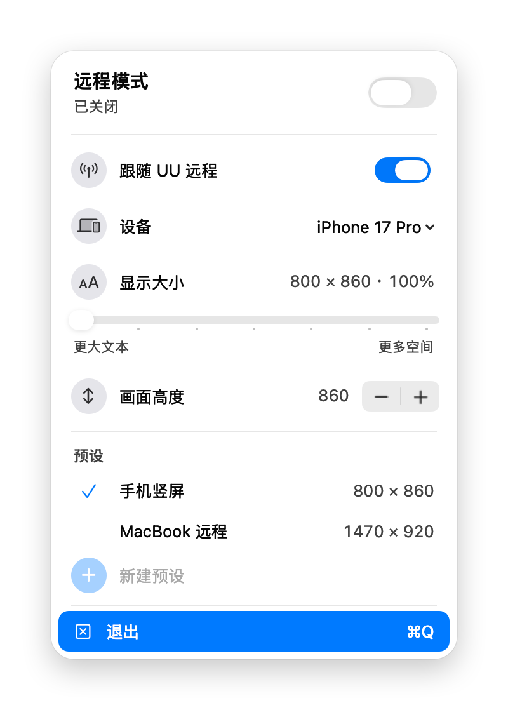

<p align="center"></p>

<h1 align="center">PhoneMode 远程模式</h1>

用手机竖屏远程控制 Mac 时，把 Mac 画面调成贴合手机的尺寸：比例对上手机屏幕里状态栏以下、输入法以上的那块区域，字也够大。

配合网易 UU 远程使用：UU 连上时自动切到手机尺寸，断开后切回原分辨率。其他远程软件只要显示主屏也可以，手动开关即可。

常驻在菜单栏，点图标弹出设置面板。

<p align="center">
  
  
</p>

## 为什么需要它

Mac 的屏幕是横的，手机是竖的。远程时整块横屏缩进手机，字小得看不清；手机竖着拿，下半屏还要留给输入法。远程软件自己会改分辨率，也没法关掉。

远程模式建一块虚拟屏当主屏，尺寸按手机型号算好，远程软件改了会自动改回来。画面比例刚好对上手机状态栏以下、输入法以上的区域，字也够大。

## 安装

1. 到 [Releases](https://github.com/cyanext/PhoneMode/releases) 下载 `PhoneMode-<版本>.dmg`，打开后把「远程模式」拖到「应用程序」。
2. 第一次打开如果提示「无法验证开发者」，到「系统设置 > 隐私与安全性」底部点「仍要打开」。

需要 macOS 12 或更新的版本，支持 Apple 芯片和 Intel。

## 使用

打开后菜单栏出现一个折线图标，点一下弹出面板。图标是空心方框表示关闭，实心方块表示开启。

1. 在「机型」里按品牌选手机型号，尺寸换成这款手机的推荐值。
2. 「跟随 UU 远程」默认打开：UU 连上时自动开启远程画面，断开约 6 秒后自动关闭。也可以用顶部的开关手动开关。
3. 字太大或太小，拖「显示大小」：宽高一起变，比例不变。
4. 画面底部被输入法挡住，用「画面高度」的 `−` 调矮：只改高度，每点一下 10。
5. 调好后点「新建预设」，名字自动用机型和尺寸。点预设切换，右键可以用当前尺寸覆盖或删除。
6. 点面板最下面的「退出」，显示器恢复原样。

开着 Crisp 或 BetterDisplay 时，开启远程画面前会先让它们退出，关闭后再自动打开。它们也靠虚拟屏工作，同时开会抢显示器。

## 构建

需要 Xcode 命令行工具（`xcode-select --install`）。

| 命令 | 作用 |
| --- | --- |
| `make build` | 编出 arm64 和 x86_64 通用二进制 `build/remotemode` |
| `make icon` | 生成 `build/AppIcon.icns` |
| `make app` | 组装 `build/远程模式.app`，写入 Info.plist，做 ad-hoc 签名 |
| `make dmg` | 打包 `dist/远程模式.dmg`，带「应用程序」快捷方式和使用说明 |
| `make install` | 装到 `~/Applications` 并重新打开，旧版本先正常退出 |
| `make selftest` | 真实开一次虚拟屏跑自测，约 20 秒，期间显示器会切换几次 |
| `make format` | 用 clang-format 整理代码 |
| `make clean` | 删除 `build/` |

版本号写在 `VERSION` 文件里，Info.plist 由 `Resources/Info.plist.in` 生成。编译开启 `-Wall -Wextra -Werror`。

可执行文件支持几个开发用的参数：

| 参数 | 作用 |
| --- | --- |
| `--render-icon <目录>` | 把图标各档尺寸的 PNG 写到目录里，然后退出 |
| `--quit-after <秒>` | 到时间自动退出，退出前照常恢复显示器 |
| `--appearance light\|dark` | 强制浅色或深色外观，截图用 |
| `--selftest` | 跑自测 |
| `--preview` | 只显示界面，不碰显示器，可以和正式版同时开。改界面时用它截图 |

## 目录

```
src/
  main.m               入口：命令行参数、信号处理
  AppDelegate.h/.m     菜单栏图标和面板、预设、退出时的恢复
  DisplayControl.h/.m  虚拟屏的创建、调整、镜像、关闭和恢复
  OtherApps.h/.m       开启前让 Crisp、BetterDisplay 退出，关闭后重新打开
  UUWatch.h/.m         检测 UU 远程的连接和断开
  CGVirtualDisplay.h   私有 API 的声明
  PhoneModels.h/.m     手机型号数据和推荐尺寸
  Theme.h/.m           颜色和绘图小工具
  AppIcon.h/.m         应用图标的绘制和导出
  SelfTest.h/.m        自测
Resources/
  Info.plist.in        Info.plist 模板
  使用说明.txt          放进 dmg 的说明
```

## 工作原理

1. 用 CoreGraphics 的 `CGVirtualDisplay` 建一块 Retina 虚拟显示器，分辨率就是面板里设的宽和高。虚拟屏预先放好一组档位：同比例下宽 800–1400、同宽度下高 ±300，都每 10 一档。
2. 把虚拟屏放到坐标原点，成为主屏，再让所有物理屏都镜像它。系统里始终只有这一块屏，远程软件只能截它，Dock 和窗口也不会落到别的屏上。
3. 调尺寸时在档位间切换，和在系统设置里切分辨率一样快。调过画面高度、比例变了，才按新比例重新定义一组档位。开启和关闭时屏幕先淡出、配置完再淡入，几次显示器重新配置合成一次。
4. 显示器配置一变（插拔显示器、远程软件改分辨率或换主屏），就检查上面的排列，不对就设回去，新插的显示器也拉进镜像。一分钟内修满三次还不对，就关掉虚拟屏。
5. 关闭或退出时解除镜像、销毁虚拟屏，等它下线后把各物理屏切回原来的分辨率。
6. 建虚拟屏之前先拍下各物理屏的分辨率（虚拟屏一接上，系统可能先把物理屏从缩放模式切到原生分辨率），镜像时把它记进设置。程序被强杀或崩溃后，下次启动先按这些记录恢复。
7. 虚拟屏被系统回收时（比如睡眠唤醒后）按当前尺寸自动重建，一分钟内最多三次。
8. 跟随 UU 远程：UU 被连上时，它的服务进程会在最顶层盖一个全屏的提示框窗口。每 0.5 秒看一次这个窗口在不在，出现就开启，连续消失约 6 秒就关闭。读窗口列表不需要额外权限。

设置存在 `local.remotemode` 域：`model`、`w`、`h` 是当前型号和尺寸，`presets` 是预设数组，每项有 `name`、`model`、`w`、`h`；`restore` 是各物理屏的原分辨率，正常关闭后清掉；`relaunchApps` 是让出来、关闭后要重新打开的程序；`followUU` 是是否跟随 UU 远程。

## 私有 API 的风险

`CGVirtualDisplay` 系列类没有公开文档。

- 用了私有 API 的应用上不了 Mac App Store。
- 系统升级后这些类可能改名、改行为或被移除。程序按类名在运行时取类，取不到时提示「虚拟屏创建失败」，其余界面照常可用。
- 没有做公证，安装时需要手动放行。

## 推荐尺寸怎么算

以华为 Pura X View 实测好用的 980×820 为基准。

1. 每款手机的屏幕物理尺寸（毫米）由官方分辨率和 ppi 换算。
2. 宽度让字在各手机上一样大：基准是 980 点对应 82.6 毫米，约每毫米 11.9 点。宽度 = 屏幕宽 × 11.9，取整到 10，最小 800。
3. 高度让画面刚好落在输入法上方：可用高度 = 屏幕高 − 状态栏 − 底部手势条 − 输入法和远程工具栏（约 57 毫米），高度 = 宽度 × 可用高度 ÷ 屏幕宽，取整到 10。

例：iPhone 16 Pro Max 屏幕 72.9×158.4 毫米，状态栏 10.3，手势条 5.6。宽度 72.9 × 11.9 ≈ 860；可用高度 158.4 − 10.3 − 5.6 − 57 = 85.5，高度 860 × 85.5 ÷ 72.9 ≈ 1010。

数据在 `src/PhoneModels.m`。输入法高度因人而异，推荐值只是起点，用「显示大小」和「画面高度」微调后存成预设。

## 许可

[MIT](LICENSE)
